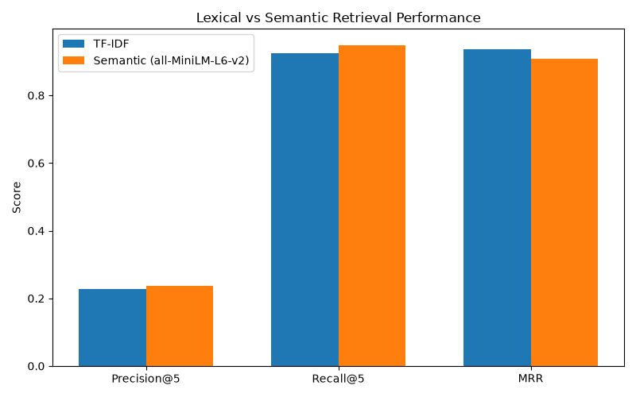
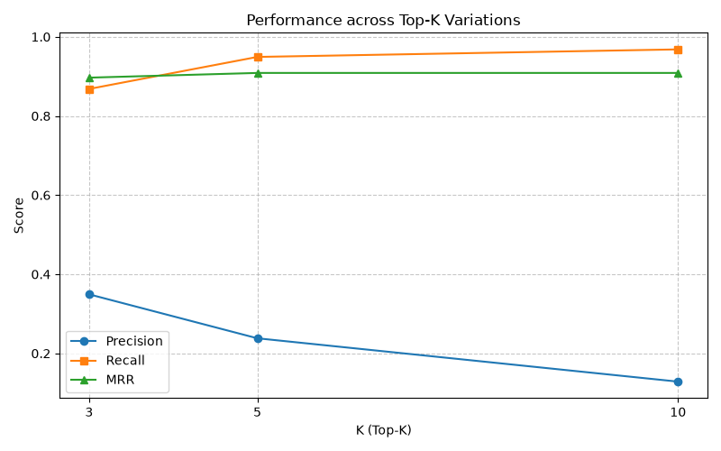
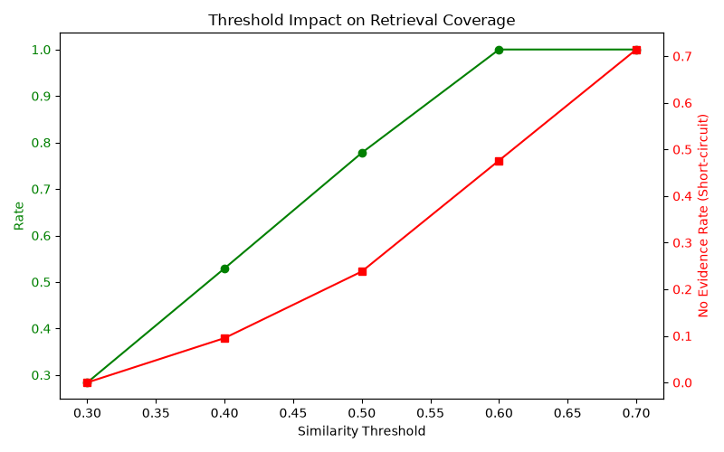
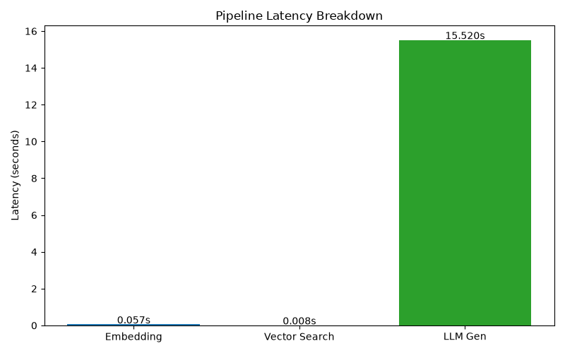

# StudentSphere RAG Experimental Evaluation Report

## 1. Dataset Characterization
**Data Source:** vector_store.pkl (Mock Evaluation Dataset)

| Metric | Value |
|---|---|
| Total Experiences | 20 |
| Companies | 12 |
| Roles | 15 |
| Years | 2 |
| Chunks Indexed | 20 |

## 2. Retrieval Baseline Comparison
Comparing standard TF-IDF (lexical) against the `sentence-transformers` vector search.

| Metric | TF-IDF | Semantic (RAG) |
|---|---|---|
| Precision@5 | 0.229 | 0.238 |
| Recall@5 | 0.925 | 0.949 |
| MRR | 0.937 | 0.909 |

## 3. Top-K Evaluation
| K | Precision@K | Recall@K | MRR | Avg Latency (s) | Avg Retrieved Chunks |
|---|---|---|---|---|---|
| 3 | 0.349 | 0.868 | 0.897 | 0.113 | 3.0 |
| 5 | 0.238 | 0.949 | 0.909 | 0.082 | 5.0 |
| 10 | 0.129 | 0.968 | 0.909 | 0.072 | 10.0 |

## 4. Similarity Threshold Impact
| Threshold | Relevant Retrieval Rate | Irrelevant Retrieval Rate | No-Evidence Rate | Avg Chunks |
|---|---|---|---|---|
| 0.3 | 0.284 | 0.716 | 0.000 | 3.9 |
| 0.4 | 0.529 | 0.471 | 0.095 | 1.6 |
| 0.5 | 0.778 | 0.222 | 0.238 | 0.9 |
| 0.6 | 1.000 | 0.000 | 0.476 | 0.5 |
| 0.7 | 1.000 | 0.000 | 0.714 | 0.3 |

## 5. Latency Analysis
| Component | Mean (s) | Median (s) | Std Dev (s) | Min (s) | Max (s) |
|---|---|---|---|---|---|
| embedding | 0.057 | 0.039 | 0.053 | 0.032 | 0.216 |
| vector_search | 0.008 | 0.003 | 0.014 | 0.002 | 0.049 |
| retrieval_total | 0.065 | 0.042 | 0.055 | 0.034 | 0.264 |
| llm_generation | 15.520 | 6.685 | 14.631 | 3.734 | 36.142 |
| end_to_end | 15.585 | 6.727 | 14.632 | 3.767 | 36.406 |

## 6. Generative Accuracy: RAG vs Non-RAG
Generative evaluation utilizing `gemini-3.6-flash`. The LLM-as-a-judge was omitted to conserve API quota. Below is a manual side-by-side comparison of generated output context.

### Query: What questions are asked in Amazon SDE interviews?
**Sources Used (RAG):** 0

**Baseline Answer (No Context):**
> Insufficient retrieved evidence is available to answer this question.

**RAG Answer:**
> Insufficient retrieved evidence is available to answer this question. Try a broader question or add relevant interview experiences.

---
### Query: What topics commonly appear in software engineering interviews?
**Sources Used (RAG):** 1

**Baseline Answer (No Context):**
> Insufficient retrieved evidence is available to answer this question.

**RAG Answer:**
> Based on the provided interview experience, software engineering interviews commonly cover the following topics:

* **Data Structures**
* **Algorithms**
* **System Design**

---
### Query: What should I know for Stripe backend?
**Sources Used (RAG):** 1

**Baseline Answer (No Context):**
> Insufficient retrieved evidence is available to answer this question.

**RAG Answer:**
> Based on the provided interview experience, for a Stripe backend interview you should be prepared for the following:

* **Practical Implementation:** The interview was described as very practical rather than purely theoretical.
* **API Integration:** You may need to integrate a dummy payment API.
* **Error Handling & Resiliency:** You should know how to handle failure scenarios and implement retries gracefully.

---
### Query: Data science questions at Amazon
**Sources Used (RAG):** 0

**Baseline Answer (No Context):**
> Insufficient retrieved evidence is available to answer this question.

**RAG Answer:**
> Insufficient retrieved evidence is available to answer this question. Try a broader question or add relevant interview experiences.

---
### Query: Geospatial indexing at Uber
**Sources Used (RAG):** 1

**Baseline Answer (No Context):**
> Insufficient retrieved evidence is available to answer this question.

**RAG Answer:**
> Based on the provided interview experiences:

In an **Uber Backend interview**, the discussion on geospatial indexing involved the following details:

* **Task:** Designing a system to match riders with drivers efficiently.
* **Key Techniques/Data Structures:** Using **QuadTrees** or **Geohashes** for geospatial indexing.

---
## 7. Known Limitations
- **Dataset:** MongoDB was empty locally, so the experiment was evaluated on 20 explicitly designated mock interview profiles within the vector store.
- **Gemini Quota:** Generative LLM evaluation was limited to 5 targeted queries to prevent HTTP 429 quota exhaustion. Statistical LLM-as-a-judge was explicitly disabled.
